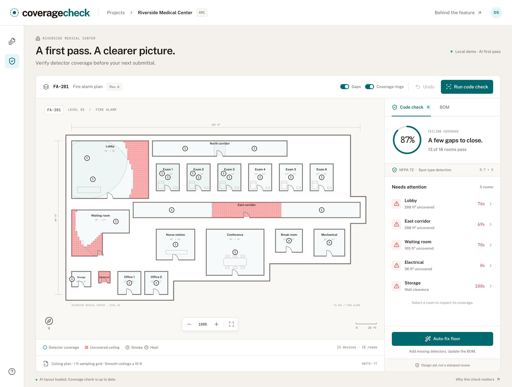

# NFPA 72 Coverage Check

Verify AI-placed fire alarm detectors against the NFPA 72 0.7 × S coverage rule, see the blind spots, fix them in one click, and keep the bill of materials in sync.

An independent project in fire-alarm design and code compliance. Built with Codex, verified by Claude Code.



## The problem

Software can now place a first pass of smoke and heat detectors on a floor plan in minutes. That layout is only useful once someone proves it meets code. NFPA 72 requires that every point on the ceiling is within 0.7 × the detector's listed spacing of a detector (the "Point 7" rule). For a 30 ft listed smoke detector that is a 21 ft radius, room by room, around every corner of every L-shaped corridor.

Today that check is done by eye: trace the radius, inspect the corners, count again. Designers in fire-alarm forums regularly ask how spacing works in irregular rooms, and requirements vary by jurisdiction. Users of popular design tools in this space get visual blind-spot overlays for security cameras, but not a code check for fire detectors. So the AI saves time on placement and the designer spends it back on review.

## Why this feature

The gap between "AI first pass" and "code-compliant layout" is the review step, and the core spatial rule is mechanical enough for a computer to check. A coverage check turns "reviewed by your designer" into a review that is checked, not eyeballed.

The alternative considered was a revision diff with change orders (match devices across two drawing revisions and price the delta). It was dropped because popular PDF markup tools already overlay revisions, and it needs two aligned sheets before it helps. Coverage Check helps on the very first drawing.

## What it does

On a sample 18-room hospital floor (Riverside Medical Center, sheet FA-201), a designer can:

- see uncovered ceiling area as a heatmap and coverage rings per detector
- open any failing room for the reason and rule reference (gap distance, missing detector, wall clearance, wrong detector type)
- fix one room or the whole floor in one click; the engine adds the fewest detectors it can find, moves badly placed ones and swaps smoke for heat where required
- review the bill of materials change, and undo the whole fix

`/story` is an animated explainer: the problem in this domain, why this feature, how the check works, and the measured impact on the sample floor.


## Run locally

Node **20 or newer** and npm are required. No environment variables, keys, database, or external API calls are needed.

```sh
npm install
npm run dev
```

- Workspace: http://127.0.0.1:5173/
- Animated explainer: http://127.0.0.1:5173/story
- Express API: http://127.0.0.1:4000/api/sheets/FA-201

Vite proxies `/api` to Express. Restarting the server resets the in-memory demo and undo history. Changes are shared by tabs connected to the same server.

```sh
npm test
npm run typecheck
npm run lint
npm run build
npm start
```

The production command serves both the compiled client and API at http://127.0.0.1:4000. Stop the dev server first to free port 4000. `PORT` may override the production server port. Both servers bind to loopback by default.

`npm run format` formats source with Prettier. `.env.example` documents optional future integration settings; the demo does not read credentials or call any external service.

## Exact seed results

| Measure | AI first pass | After auto-fix floor |
| --- | ---: | ---: |
| Area-weighted sampled coverage | 87.24590163934427% | 100% |
| Rooms passing | 13 / 18 | 18 / 18 |
| Rooms failing | 5 | 0 |
| Violations | 6 | 0 |
| Detectors | 23 | 27 |
| Smoke detectors | 21 | 25 |
| Heat detectors | 2 | 2 |
| Bases | 23 | 27 |

Four detectors are added; Storage’s detector is moved away from its wall. The material delta is **$233.20**, including bases. The story computes its metrics from the shared engine and seed, and measures check time live with `performance.now()`. Its 10–20 minute review-saving estimate is explicitly illustrative, not a measured customer outcome.

The seed is tuned so the first pass fails in five rooms. Break Room starts with a correct heat detector; wrong-type detection and swapping are independently tested. The final values above are pinned in tests.

## How it works

- `sampleRoom` samples 1 ft grid-cell centres strictly inside simple room polygons. Concave L-shaped rooms are supported.
- A detector covers a sample in the same room when distance ≤ 0.7 × listed spacing and its line segment remains inside the polygon. Segment checks split at wall intersections, so they cannot skip narrow notches as a coarse ray march might.
- `checkRoom` reports uncovered area, farthest gap, missing detectors, the specified 4 in sidewall-clearance review rule, and smoke devices in heat-only rooms. Missing-detector gap distances are `null`, not non-JSON infinity.
- `checkSheet` weights coverage by actual polygon area. Clearance and device-type violations affect room pass/fail independently of coverage percentage.
- `autoFix` tries a 2 ft candidate grid, each candidate at least 1 ft from walls. Each step covers the most remaining samples; ties prefer the uncovered centroid, then x, then y. It stops at full sampled coverage or 12 additions. It also moves wall-clearance violations and swaps incorrect smoke devices to heat.
- Greedy set cover gives **near-minimal**, deterministic additions; it is not a proof of a global minimum. Visibility sets are cached within each fix operation.
- `buildBom` groups by SKU, adds one base per detector, and rounds currency to cents. Labor hours are separate from material totals. Changes generate quantity diffs.
- A repository transaction stores one snapshot per effective fix. Undo restores all devices, positions, types, coverage, and BOM. No-op checks/fixes do not consume undo history.

## Workspace and story

Click a failing-room row or room polygon to focus the drawing. Press **Esc** or **Full floor** to return. All failing-room rows are keyboard buttons. Gaps and rings can be toggled independently; rings are clipped to their own room (the coverage check additionally applies line of sight). Use the zoom controls or fit-to-view button to inspect the drawing.

Auto-fix animates added device symbols and fading gap cells. The score animates to its measured result. The BOM tab highlights changed quantities. Errors are surfaced, retry is available, and a live status announces completed operations.

The six-section `/story` uses GSAP ScrollTrigger for a pinned, scrubbed five-stage real-floor diagram, and Framer Motion for entrances, device additions, and counters. `prefers-reduced-motion` replaces pinning with five static stages, skips the timer, and disables spatial and looping animation. Fonts (Public Sans, JetBrains Mono) are bundled locally via Fontsource, avoiding Google Fonts requests at runtime.

Screenshots: [docs/plan.png](docs/plan.png), [docs/plan-fixed.png](docs/plan-fixed.png), [docs/story.png](docs/story.png), [docs/story-impact.png](docs/story-impact.png).

## Architecture and stack

A typical modern TypeScript stack for drawing-centric web apps:

- **Client:** Vite 5, React 18, strict TypeScript 5, React Router 6, Tailwind CSS 3, Lucide, Framer Motion 11, GSAP 3 + ScrollTrigger.
- **Server:** Node 20+, Express 4, TypeScript via `tsx` for development; compiled Node ESM for production. Zod validates request bodies.
- **Shared:** pure geometry, sampling, checks, auto-fix, and BOM modules in `shared/`.
- **Providers:** `LayoutProvider` represents proprietary vector segmentation and AI placement. `MockLayoutProvider` supplies local `server/seed/riverside-fa201.ts`. The adapter comment marks the future integration point for a real placement service.
- **Storage:** `DeviceRepository` abstracts transactions and undo. `InMemoryDeviceRepository` is the default. `PostgresDeviceRepository` is an intentionally unwired stub, with tables and indexes in `server/db/schema.sql`. A real adapter must introduce async SQL methods, a driver, sheet-level transaction locking, and injection through `createApp` before `DATABASE_URL` is used.
- **Tests/tooling:** Vitest, Testing Library, jsdom, Supertest, ESLint/typescript-eslint, Prettier, concurrently. Playwright Core is used only for local browser verification.

No proprietary service is called. No credentials are present. `.gitignore` excludes `.cache/`, `node_modules/`, `.venv/`, environment secrets, and build outputs.

## API

All endpoints are under `/api/sheets/:id`, with the seeded ID `FA-201`.

| Method | Path | Result |
| --- | --- | --- |
| GET | `/` | Sheet and room geometry |
| GET | `/devices` | `{ devices, canUndo }` |
| POST | `/check` | Room reports and floor summary |
| POST | `/autofix` | `{ added, moved, swapped, devices, report, bom, bomDiff, canUndo }` |
| POST | `/undo` | Restored devices, report, BOM, diff, and undo availability |
| GET | `/bom` | BOM lines and totals |

POST bodies are strict Zod objects. `/autofix` accepts `{ "roomIds": ["lobby"] }`, or `{}` to fix the entire floor. An empty `roomIds` list is a no-op. `/check` and `/undo` accept `{}`. Invalid bodies/unknown rooms return 400; unknown sheets return 404; an empty undo stack returns 409.

## Verification

All **22 tests** pass, along with typecheck, lint, and the production build. Browser verification passed all 12 route/viewport combinations, all five animated story stages, fix/undo flows, and checks for zero console errors and zero external page requests.

The suite covers geometry, strict edges, concave visibility, degenerate polygons, sampling, the exact radius, hand-computed corridor gaps, 3.9 vs 4.1 in wall clearance, missing and wrong detectors, pinned seed metrics, deterministic auto-fix, minimum placement clearance, BOM arithmetic, API persistence/undo/body validation, the full UI fix/BOM/undo flow, and reduced-motion story sections.

For browser verification on macOS with local Google Chrome:

```sh
# With the app running on 4000 (or set VERIFY_URL to the dev URL)
node docs/verify-browser.mjs
```

The script creates a profile and temporary files inside `.cache/`, checks both pages at 320, 375, 414, 768, 1280, and 1920 px, exercises room/floor fixes and undo, scrolls the animated story, and asserts no console errors or external page requests. Results are saved to `docs/browser-results.json`; screenshots are saved under `docs/`. Update the executable path for another OS.

## Scope and limitations

This is a **design aid, not a stamped engineering review**. The configured model covers ceiling-mounted spot detectors on smooth, flat ceilings ≤ 10 ft. It does not model beams, sloped or high ceilings, obstructions below the ceiling, airflow, device listings beyond supplied spacing, occupancy-specific detection requirements, notification appliances, or local AHJ amendments. The 4 in clearance threshold and heat-only tags are project review assumptions; confirm applicable requirements with a qualified designer.

“100%” means all sampled points pass the configured checks; a 1 ft grid is not a mathematical proof of coverage of every continuous ceiling point. Rings are a visual distance aid; the conservative line-of-sight check is authoritative. Seed geometry is synthetic, with schematic doors and furniture. Doors are drawn as 3 ft gaps and arcs but do not change room containment. This is a single-user local prototype, without authentication or durable storage.

Future extensions: camera FOV wedges, notification-appliance candela/spacing, reviewed per-AHJ rule packs, real placement and PostgreSQL adapters, and a `check_sheet` MCP tool.

## Built with Codex, verified by Claude Code

Codex built this from a written product plan. A Claude Code verifier then checked it independently:

- clean `npm ci`, then `npm test` (22/22 passing), `npm run typecheck`, `npm run lint`, `npm run build`
- booted the production server and ran the API flow: check (87.2%, 5 rooms failing, 6 violations) → auto-fix floor (+4 detectors, 1 moved, 100%, 0 violations, BOM `SD-PH-2W` 21 → 25) → undo (back to the original numbers), plus a 400 on an invalid body
- headless Chrome on `/` and `/story` at 1280, 1920 and 375 px: no console errors, no requests outside localhost, no horizontal scroll
- review fix: the coverage-gap message now gives the radius for the room's detector type (21.0 ft smoke, 35.0 ft heat) rather than always saying 21.0 ft

